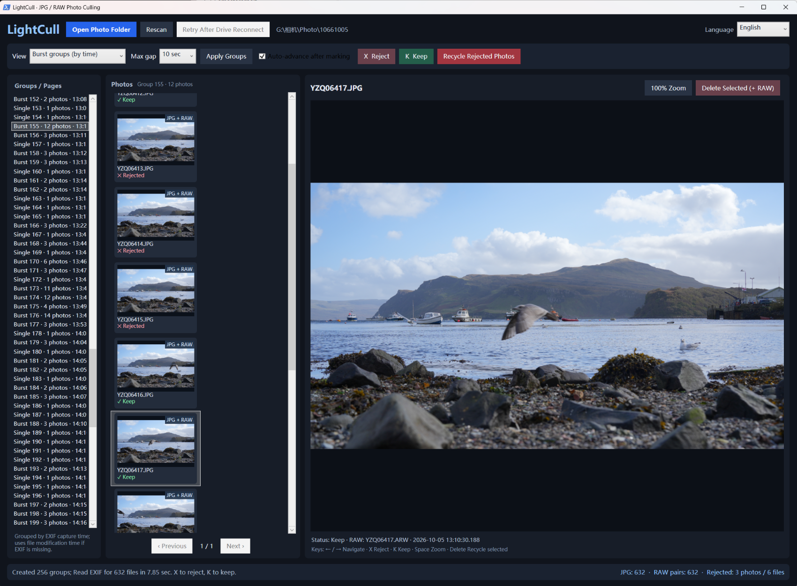
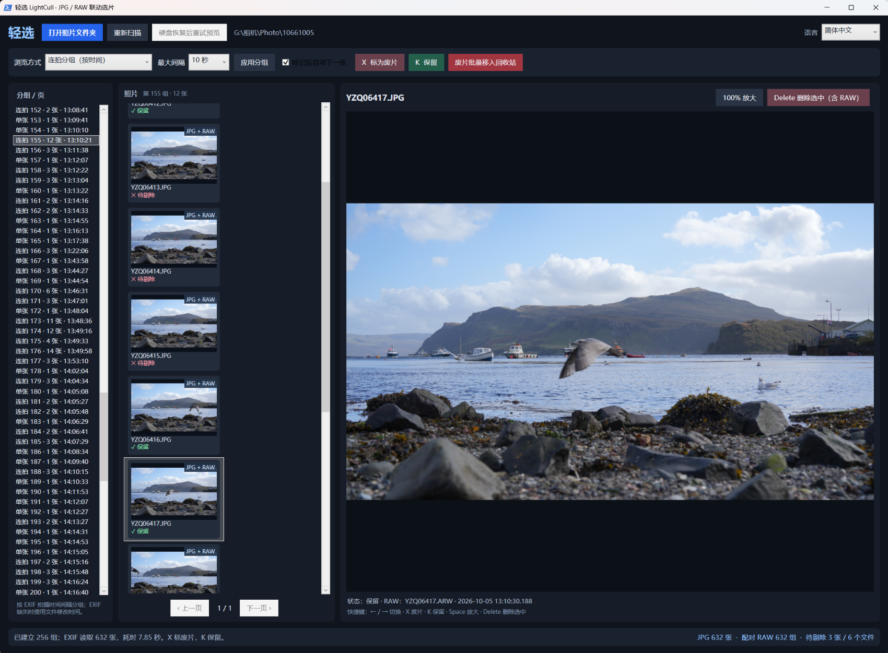

# LightCull / 轻选

**A lightweight, free, open-source JPG/RAW photo culling tool for Windows**  
Version **v0.2.7** — Chinese / English UI preview

[中文说明](README.md) · [Changelog](CHANGELOG.md)

> **Early preview:** v0.2.7 has received initial hands-on Windows testing in both Chinese and English. Full compatibility and paired-deletion regression testing are not complete. Back up originals and test paired deletion on duplicates before processing important shoots.

> ⚠️ **Security software compatibility warning (v0.2.7):** 360 Security has been observed automatically blocking LightCull's JPG rename/move operations. This may interrupt a batch operation, leave paired JPG/RAW files in inconsistent locations, or cause some JPGs to reappear in the source folder. Similar interference from other antivirus or ransomware-protection products is possible but has not been verified.
>
> **Before use, check your security software's protection/blocking history.** Prefer narrowly scoped **allow/trust rules** for a verified LightCull extraction directory and the specific operations being blocked, then test on copied photos. Because v0.2.7 starts `powershell.exe` via `Start_LightCull.bat`, **trusting the folder alone may not resolve the block**. If precise exceptions are unavailable, you may temporarily exit the conflicting protection only after considering the risk, and **re-enable it immediately afterward**. Do not leave all antivirus protection disabled, or broadly allowlist `powershell.exe` or entire photo drives.
>
> If an operation is blocked, the window closes unexpectedly, or a batch stops midway, **do not immediately retry**. Reconcile the source folder, Windows Recycle Bin, and each JPG/RAW pair first; a logged success is not proof that the file reached the Recycle Bin.

## Screenshots

Click an image to view the full-size screenshot.

| English interface | 简体中文界面 |
| --- | --- |
|  |  |

## Features

- Browse JPG/JPEG files directly from a folder without a catalog import. Subfolders are not scanned.
- Automatically pair JPG and RAW files **in the same folder with the same filename stem**, such as `DSC0001.JPG` + `DSC0001.ARW`.
- Navigate quickly with `←`/`→`; `X` marks a photo for rejection, `K` keeps it, and `Space` toggles 100% zoom.
- Group bursts by EXIF capture-time intervals; experimental similar-frame grouping.
- Respect EXIF Orientation in thumbnails and previews without modifying originals.
- Recycle selected JPGs **together with their matching RAW files**, only after confirmation. There is no fallback to permanent deletion.
- Detect drive I/O faults, pause image loading, disable deletion, and require a re-scan to verify pairs after recovery.
- Switch **简体中文 / English** from the top-right menu. The switch applies immediately without reopening the folder or discarding rejection marks; the language preference is saved to `%LOCALAPPDATA%\LightCull\settings.json` (never inside your photos folder).

## Installation

Requires Windows 10/11 with Windows PowerShell 5.1 and the built-in .NET Framework WPF components. No Python, .NET SDK, or third-party runtime required.

1. Download `LightCull_Windows_v0.2.7_Portable.zip` from [Releases](../../releases), or download the source ZIP.
2. Extract the **entire archive** into a regular local directory. Keep `LightCull.ps1`, `LightCull.I18n.ps1`, and `LightCull.Core.cs` together.
3. Double-click `Start_LightCull.bat`. You can also drag a photo folder onto the BAT file.
4. Choose your photo folder, grouping mode, and maximum burst gap; click **Apply Groups**.
5. Mark photos with `X` and `K`, verify the selected and paired-file counts, then use **Recycle Rejected Photos** to confirm.

This is a PowerShell + WPF project, **not an EXE installer**. The BAT launches `powershell.exe -NoProfile -STA -ExecutionPolicy Bypass` for that process only (it does not permanently change execution policy). The built-in `Add-Type` compiler compiles the included C# helper code when starting. Inspect the source and comply with your organization's device policy.

## Deletion safeguards

- **Back up important shoots and test on 5–10 copied JPG/RAW pairs first.**
- **360 Security compatibility:** Check its document/image protection blocking history before use. Prefer narrowly scoped trust/allow rules; if protection must be temporarily disabled, re-enable it immediately after the controlled operation.
- JPG and RAW recycling is **not atomic**: a drive disconnecting midway can leave a partially recycled pair. Inspect the original folder and Recycle Bin after any failure.
- Only matching RAW files in the current folder are handled. XMP sidecars are not deleted, and subfolders are not scanned.
- If a USB HDD reports `0x8007045D` or similar device I/O errors, check the USB cable, power supply, and disk health before resuming deletion.
- Culling marks are not saved permanently yet. The persisted language preference does **not** persist marks.

## Files

| File | Purpose |
|---|---|
| `LightCull.ps1` | WPF UI, culling flow, grouping, recycling logic |
| `LightCull.I18n.ps1` | Chinese/English strings and saved UI preference |
| `LightCull.Core.cs` | Image/EXIF background decoding helpers (unchanged since v0.2.6) |
| `Start_LightCull.bat` | Windows launcher |
| `Check_Runtime.bat` | Basic WPF runtime diagnostic |
| `README.md` | Chinese documentation |
| `LICENSE` | MIT open-source license |

## Limitations / feedback

JPG/JPEG preview only; not a RAW editor. Visual similarity grouping is experimental. There is no signed installer or standalone EXE yet. If you encounter a problem, please open a GitHub Issue with the app version, Windows version, steps to reproduce, and error message. **Do not share private shoot photos, sensitive filesystem paths, or drive serial numbers.**

Licensed under the [MIT License](LICENSE).
