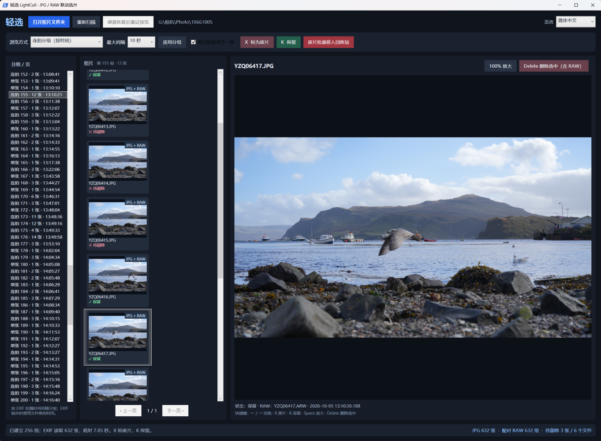
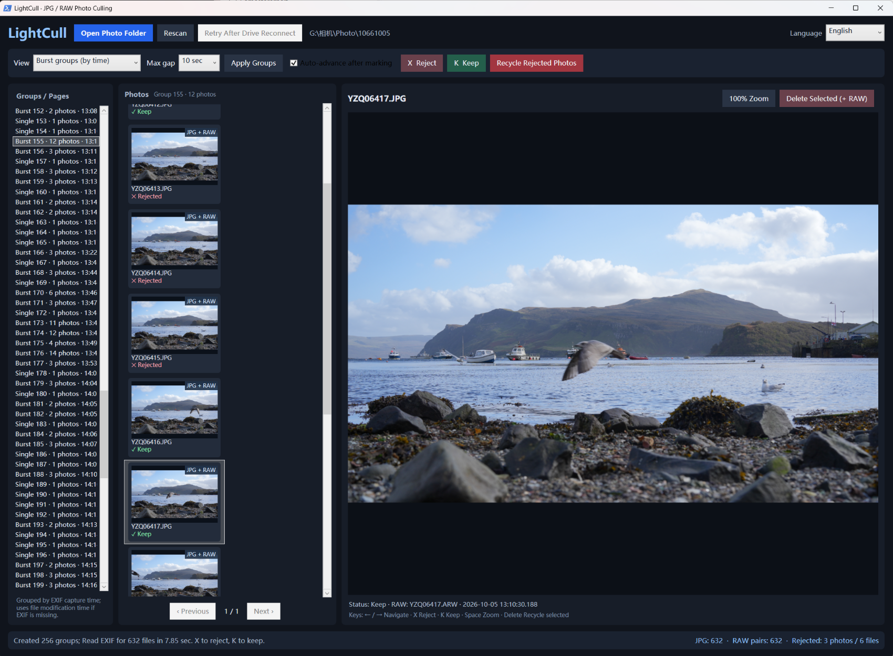

# LightCull / 轻选

**Windows JPG / RAW 联动选片工具 · 免费开源 · v0.2.7 双语预览版**

[English documentation](README.en.md) · [中文说明](#中文使用说明) · [更新记录](CHANGELOG.md)

> **测试阶段 / Preview release:** v0.2.7 已在 Windows 上进行初步实机试用，中文及英文界面均可运行；尚未完成系统性兼容性与批量删除回归测试。请先备份原始照片，并在副本上验证 JPG/RAW 联动删除。  
> v0.2.7 has received initial hands-on testing on Windows with both Chinese and English interfaces. Comprehensive compatibility and paired-deletion regression tests are still pending. Back up originals and test on copies first.

> ⚠️ **安全软件兼容性警告（v0.2.7）：** 已确认 360 安全卫士曾自动阻止 LightCull 的 JPG 文件重命名/移动操作，导致批量操作中断、JPG 与配对 RAW 状态不一致，部分 JPG 可能在原目录重新出现。其他杀毒软件或防勒索保护也可能干预文件操作，但尚未逐一验证。
>
> **使用前请检查安全软件的防护/拦截记录。** 优先对来源可信的 LightCull 解压目录和对应文件操作设置**有针对性的允许/信任规则**，并先用照片副本测试。请注意：v0.2.7 通过 `Start_LightCull.bat` 启动 `powershell.exe`，**仅添加文件夹信任不一定足以解除拦截**。如确实无法配置允许规则，可在了解安全风险的前提下**临时退出冲突的安全防护，操作结束后立即重新开启**；不建议长期关闭杀毒软件，也不要将整个 `powershell.exe` 或照片磁盘加入全局白名单。
>
> 一旦发生拦截、窗口意外关闭或任务中断，**请勿直接重试批量删除**。先核对原照片文件夹、Windows 回收站和配对 JPG/RAW 的实际状态；日志中的成功记录不等同于文件已进入回收站。

## 界面截图 / Screenshots

点击图片查看大图。Click a screenshot to view it in full size.

| 简体中文界面 | English interface |
| --- | --- |
|  |  |

## 中文使用说明

LightCull 是一款无需导入图库的 Windows 桌面选片工具，适合需要快速筛选大量 JPG + RAW 连拍照片的摄影师。

### 功能

- 直接打开当前文件夹浏览 JPG/JPEG；不递归扫描子文件夹。
- 自动将同文件夹、同主文件名的 JPG 和 RAW 配对（例如 `DSC0001.JPG` + `DSC0001.ARW`）。
- `←` / `→` 切换照片，`X` 标记废片，`K` 取消废片标记，`Space` 切换 100% 放大。
- 按 EXIF 拍摄时间间隔自动分组；实验性相近画面分组。
- 按 EXIF Orientation 自动调整缩略图及预览方向，不改变原图。
- 经确认后将 JPG 与匹配的 RAW 移入 **Windows 回收站**（不会回退为永久删除）。
- 磁盘 I/O 异常时暂停读取、锁定删除，恢复后需要重扫核验配对。
- **中英文界面实时切换**：窗口右上角选择「简体中文」或「English」，不需要重新扫描；选择会保存在 `%LOCALAPPDATA%\LightCull\settings.json`，不写入照片文件夹。

### 安装与使用

系统：Windows 10 / 11，Windows PowerShell 5.1、.NET Framework/WPF。无需安装 Python 或 .NET SDK。

1. 在 [Releases](../../releases) 下载 `LightCull_Windows_v0.2.7_Portable.zip`，或从仓库下载源码。
2. **完整解压** ZIP 到普通文件夹，保留 `LightCull.ps1`、`LightCull.I18n.ps1` 和 `LightCull.Core.cs` 在同一个目录。
3. 双击 `Start_LightCull.bat`；也可以把图片文件夹拖到 BAT 上打开。
4. 点击「打开照片文件夹」，选择浏览模式及连拍间隔，点击「应用分组」。
5. 使用方向键与 `X` / `K` 快速选片，最后核对删除数量和配对文件，确认后才会移入回收站。

> 这不是独立 EXE。BAT 使用 `powershell.exe -NoProfile -STA -ExecutionPolicy Bypass` 启动程序；只影响该次进程，不会永久更改系统执行策略。Windows PowerShell 会本地编译随附的 C# 源码（`Add-Type`）。请确认来源可信并遵守所在组织的设备策略。

### 安全注意

- **先备份原始素材，并先用 5–10 对复制的 JPG/RAW 进行测试。**
- **360 安全卫士兼容性：**运行前检查并处理其「文档/图片保护」拦截记录；优先使用最小范围的信任/允许规则。必要的临时关闭防护仅限受控操作，完成后立即重新开启。
- JPG 与 RAW 进入回收站不是原子事务：存储设备中途断开可能导致仅部分文件成功操作。发生异常时请检查原文件夹及回收站。
- 只会尝试匹配当前文件夹中的同名 RAW；不会删除 XMP 边车文件，也不会处理其他子文件夹。
- 遇到移动机械硬盘的 `0x8007045D` 等 I/O 错误，应优先检查 USB 数据线、供电和硬盘健康状态，暂缓删除。
- 目前选片标记不自动持久化到磁盘；关闭程序后标记可能丢失。保存的语言选择与选片标记无关。

### 源码文件

| 文件 | 用途 |
|---|---|
| `LightCull.ps1` | 界面与选片、分组、回收站工作流程 |
| `LightCull.I18n.ps1` | 简体中文和英文文本、语言偏好保存 |
| `LightCull.Core.cs` | JPG/EXIF 后台解码辅助代码（延续 v0.2.6） |
| `Start_LightCull.bat` | 双击启动入口 |
| `Check_Runtime.bat` | Windows WPF 运行环境检测 |
| `README.en.md` | 英文说明 |
| `LICENSE` | MIT 许可证 |

### 限制和反馈

目前仅支持 JPG/JPEG 预览，不是 RAW 编辑器；视觉相似分组仍为实验性功能。项目处于早期测试阶段，暂未提供签名 EXE 或安装程序。欢迎在 GitHub Issues 提交复现步骤、Windows 版本及错误信息（不要上传私人原图、完整私人文件路径或硬盘序列号）。

**License:** MIT，参见 [LICENSE](LICENSE)。
